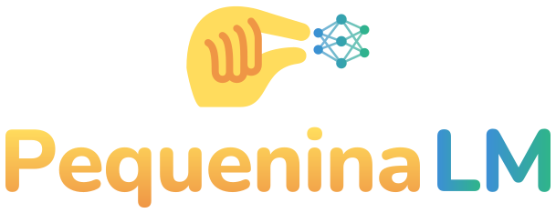

<p align="center">
  
</p>

<p align="center">
  <b>Um modelo de linguagem pequeno em Português de Portugal</b><br/>
  <sub>50M</sub>
</p>

<p align="center">
  
  
  
  
  
</p>

<br/>

## O que é

A PequeninaLM é um modelo de linguagem com cerca de 52 milhões de parâmetros, treinado do zero e só em português de Portugal. Leu a Wikipédia convertida para PT-PT e aprendeu a conversar com 80 mil conversas escritas de raiz em português europeu.

Aqui está o código para a treinar, os prompts usados para gerar as conversas e o modelo em GGUF. A versão para usar com o `transformers`, os exemplos e os detalhes do treino estão no [Hugging Face](https://huggingface.co/brunuu/PequeninaLM).

| | |
|:--|:--|
| **Arquitetura** | Llama com 12 camadas e 51,8 milhões de parâmetros |
| **Pré-treino** | 275 milhões de tokens da Wikipédia, 2h27 numa A100 |
| **SFT** | 80 000 conversas, 34 minutos numa RX 7800 XT |

<br/>

## Experimentar

Abre um dos ficheiros da pasta `gguf/` no LM Studio, ou corre no llama.cpp:

```bash
llama-cli -m gguf/pequeninalm-f16.gguf
```

<br/>

## O que vem no repositório

```
├── gguf/
│   ├── pequeninalm-f16.gguf         o modelo para llama.cpp, LM Studio e Ollama
│   └── pequeninalm-q8_0.gguf        o mesmo a 8 bits, com metade do tamanho
├── prompts/
│   ├── conversas_curtas.md          prompt para as conversas de uma volta
│   └── conversas_longas.md          prompt para as conversas longas, identidade e desabafos
├── src/
│   ├── Criar_PequeninaLM.py         corre as fases todas por ordem
│   ├── tokenizer.py                 treina o tokenizer e tokeniza o corpus
│   ├── pretreino.py                 pré-treino do modelo base
│   └── sft.py                       ensina o modelo a conversar
├── requirements.txt                 dependências para o PC (PyTorch com ROCm, placas AMD)
└── requirements-runpod.txt          dependências para o RunPod (PyTorch com CUDA, placas NVIDIA)
```

<br/>

## Como recriar o modelo

Os dados não vêm no repositório. Antes de treinar tens de preparar duas pastas.

**`dados_ptpt/`** com o texto do pré-treino, em ficheiros `train-*.jsonl` e `val-*.jsonl`, um artigo por linha no formato `{"text": "..."}`. Eu usei a Wikipédia em português (`wikimedia/wikipedia`, versão 20231101.pt). Tirei os artigos escritos sobretudo em português do Brasil, converti os restantes para PT-PT e limpei as referências, as predefinições e os artigos demasiado curtos.

**`dados_sft/`** com as conversas, em ficheiros `.jsonl`, uma por linha no formato `{"messages": [{"role": "user", "content": "..."}, {"role": "assistant", "content": "..."}]}`. Gerei-as com a API do DeepSeek usando os prompts da pasta `prompts/`, em lotes de 40 com temas, nomes e terras escolhidos ao acaso. Cada conversa passou por um validador que deita fora palavras do Brasil, gerúndio, acentos em falta, frases feitas, respostas longas demais e perguntas repetidas.

Com as duas pastas prontas:

```bash
pip install -r requirements.txt
python src/Criar_PequeninaLM.py
```

Treina o tokenizer, faz o pré-treino e no fim o SFT. O pré-treino precisa de uma GPU a sério. O SFT corre bem numa placa de jogos.

<br/>

## Créditos

**Wikipédia.** Todo o conhecimento do modelo vem dos artigos da [Wikipédia em português](https://pt.wikipedia.org), escritos por milhares de voluntários, sob a licença [CC BY-SA](https://creativecommons.org/licenses/by-sa/4.0/deed.pt).

**Twemoji.** A mão do logótipo é o emoji 🤏 do [Twemoji](https://github.com/jdecked/twemoji), © Twitter, Inc. e outros contribuidores, usado sob a licença [CC BY 4.0](https://creativecommons.org/licenses/by/4.0/deed.pt).

## Licença

MIT. Podes usar, alterar e distribuir à vontade, incluindo em projetos comerciais.
